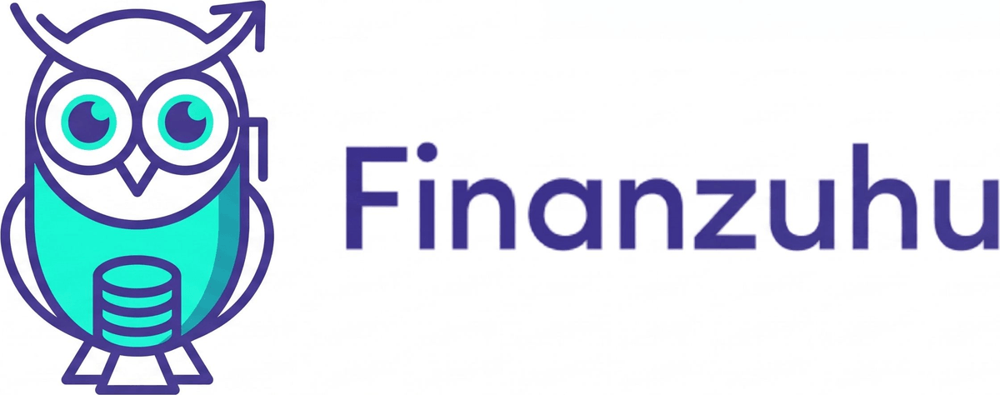
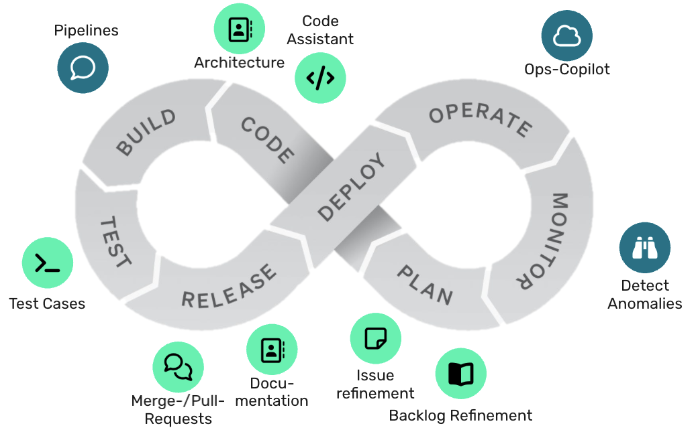
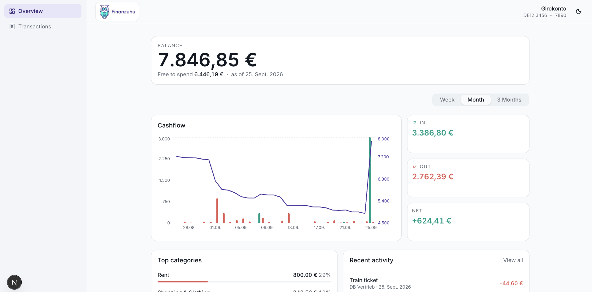
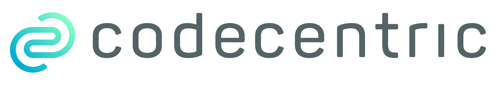

<div align="center">



# AI-Assisted SDLC Base Repository

**A starter project for AI-assisted development. Make it whatever you need.**



</div>

## Choose an app

Finanzuhu is a teaching project for AI-assisted coding. Choose a language
implementation under [`apps/`](apps/); each app has its own stack and setup.
Shared workflow, sample data, and tickets stay at the repository root.

The TypeScript web app is in [`apps/typescript/`](apps/typescript/README.md).
The Python web app is in [`apps/python/`](apps/python/README.md).
The Java web app is in [`apps/java/`](apps/java/README.md).

## Quickstart: TypeScript

```bash
npm --prefix apps/typescript install
npm --prefix apps/typescript run dev     # http://localhost:3000
npm --prefix apps/typescript test
```

Then take the first ticket through the loop in OpenCode:

```text
/refine-ticket ST-001
```

## Quickstart: Python

```bash
cd apps/python
uv sync --extra dev
uv run flask --app finanzuhu run --debug  # http://localhost:5000
uv run pytest
uv run ruff check .
```

## Quickstart: Java

```bash
./apps/java/mvnw -f apps/java/pom.xml spring-boot:run  # http://localhost:8080
./apps/java/mvnw -f apps/java/pom.xml verify
```

Requires Java 25. See the [Java README](apps/java/README.md) for browser tests
and packaged-JAR setup.

## How to use it

- **Workshop:** branch `ai-enablement-<n>` off `main`.
- **On your own:** fork it.
- **Other tools:** rename `.opencode/` to `.claude/` (Claude Code) or
  `.github/` (Copilot). All of them read [`AGENTS.md`](AGENTS.md).

The branch `ai-enablement-1` shows where the first workshop ended up.

## Find your way

| read                                              | to learn                                          |
| ------------------------------------------------- | ------------------------------------------------- |
| [`CONCEPT.md`](CONCEPT.md)                        | the idea, the default flow and the harness        |
| [`sdlc/README.md`](sdlc/README.md)                | the flow: which ticket file goes where            |
| [`.opencode/skills/`](.opencode/skills/README.md) | one skill per step                                |
| [`sdlc/standards/`](sdlc/standards/)              | Definition of Ready / Done, architecture, prompts |

## Finanzuhu, the starter app



Two screens: **Overview** (`/`) and **Transactions** (`/transactions`). The TypeScript app
uses Next.js, Tailwind v4, shadcn/ui, TanStack Query, Recharts, and Vitest. The
Python implementation uses Flask, Jinja templates, responsive CSS, browser
JavaScript, an inline SVG chart, and pytest.
The Java implementation uses Spring Boot, Thymeleaf, responsive CSS, browser
JavaScript, Chart.js, JUnit, and Playwright for Java.

- **Shared static data:** root `data/transactions.csv` and `data/account.json`.
  No database, no clock, the same numbers on every machine and in every app.
- **Seams:** UI (pages), API (`/api/summary`, `/api/transactions`), domain
  (pure functions in each app's finance module).

Demo only, not a real financial product.

<div align="center">
  <a href="https://www.codecentric.de/">
    
  </a>
  <br>
  <sub>Created in the workshop <em>AI-Assisted Coding</em> ·
  <a href="https://www.codecentric.de/">codecentric AG</a></sub>
</div>
